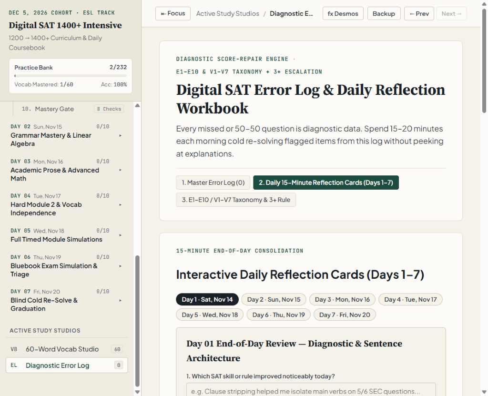

# Digital SAT 1400+ Curriculum & Interactive Courseware

A complete, Bluebook-aligned **7-day intensive curriculum**, **21-day exam preparation runway**, and **local-first interactive web courseware** designed for international (ESL) students advancing from a **`1200` baseline** (`560` Reading & Writing · `640` Math) to **`1400+`** (`650–700+` R&W · `700–750+` Math).

| Dimension | Specification |
| :--- | :--- |
| **Target Cohort** | International & non-native English speakers (`December 5, 2026` SAT runway: `Nov 14 – Dec 4`) |
| **Daily Study Load** | `4.0–5.0` effective active hours/day (`32 hr 33 min` audited across Days 1–7; `~56%` R&W / `~44%` Math) |
| **Course Structure** | `1` Master Roadmap + `7` Self-Contained Daily Workbooks (`10` guided steps per day = `70` total steps) |
| **Original Practice Bank** | **`232` SAT-Style Questions** (`125` R&W + `107` Math · `196` Multiple Choice + `36` Student-Produced Response) |
| **Academic Word Core** | **`60` High-Utility SAT Words** taught via 3-Layer Profiles, Context-Clue Polarity, and Spaced Retrieval |
| **Diagnostic & Mastery** | **`35` Student Error Case Studies** (`E1–E10` & `V1–V7` taxonomy) + **`66` Closed-Notes Mastery Gate Checks** |

---

## Interactive Web Courseware
<!-- repo-only -->



Every Markdown workbook and tracker compiles losslessly into a warm, distraction-free React single-page courseware application:

- **3-Pane Academic Layout:** Persistent Course Syllabus Rail with live accuracy and step completion counters, expandable chapter/step navigation, Focus Mode toggle, and sticky contextual breadcrumbs.
- **Bluebook-Aligned Practice Workspace:** Supports both **Tutor Check** (instant per-item grading and distractor-by-distractor explanations) and **Timed Module Simulation** (countdown module timer, ungraded pass until submission, and Day 5 `Jump to Q15 (Pass 1)` split-order routing).
- **Authentic Answer Mechanics:** Multiple-choice distractor cross-out (`Cross`), official Bluebook SPR fraction/decimal equivalence (`11/8 == 1.375`, `9/41 == 0.2195`, 5-character formatting checks), `[C]` / `[?]` confidence tagging, `⚑ Flag` review queue, and spoiler-guarded answer keys.
- **Built-In Desmos & Triage Drawer:** One-click slide-over Desmos Graphing Calculator paired with a 5-second regression, slider, and system-intersection reference card.
- **60-Word Spaced Retrieval Studio:** Searchable 7-column vocabulary notebook with `Cover Meanings` self-test mode, interactive 3-layer flashcards, personal English sentence authoring, and custom vocabulary expansion (`#61+`).
- **Diagnostic Error Log & Reflection Engine:** Inline `+ Log Mistake` capture from any practice item, `E1–E10` / `V1–V7` root-cause classification, automatic **`3+ Recurring Pattern` escalation alerts**, and structured 15-minute End-of-Day Reflection cards.
- **Supabase Auth & Cloud Sync + Guest Mode:** Sign in via **Google OAuth**, **Email & Password**, or **Magic Link / One-Time Code** to sync progress across devices (`public.profiles` & `public.course_progress` protected by Postgres Row-Level Security), or study in browser-only Guest Mode with automatic local-to-cloud merging when you sign in later.
- **Instructor Cohort & Student Inspector (`#/admin`):** Database-locked instructor access (`public.admin_users` + `claim-instructor` Edge Function) providing a read-only cohort roster and per-student drill-down across daily steps, missed/flagged R&W & Math items, `E1–E10`/`V1–V7` Error Logs, vocabulary sentences, and daily reflections.

---

## Quick Start
<!-- repo-only -->

**Prerequisites:** [Node.js](https://nodejs.org/) `18+` and `npm`.

```bash
git clone https://github.com/mikefai/sat.nov15-22.git
cd sat.nov15-22
npm install
npm run dev
```

Open **`http://localhost:5173/`** in your browser.

| Command | Description |
| :--- | :--- |
| `npm run dev` | Compiles all 11 curriculum Markdown files into `src/generated/courseData.json` and starts Vite on port `5173` |
| `npm run compile:course` | Runs `scripts/compile-course.mjs` (pre-rendering `4,100+` KaTeX expressions and linking explanations `1:1`) |
| `npm test` | Compiles and runs `scripts/verify-webapp.mjs` to verify all `7` days, `70` steps, `232` items, `60` words, and taxonomies |
| `npm run build` | Type-checks (`tsc -b`) and builds the production static bundle into `dist/` |
| `npm run preview` | Serves the production `dist/` bundle locally on port `4173` |

---

## Complete Curriculum & Study Order

| Module | File | Active Budget | Practice Items | Core Pedagogical Focus |
| :--- | :--- | :--- | :--- | :--- |
| **Part 1** | [Part-1-Seven-Day-Master-Study-Plan.md](./Part-1-Seven-Day-Master-Study-Plan.md) | Master Plan | Roadmap | Executive Dashboard, Official Resource Protocol, 8-Column Schedules (`Days 1–7`), & `Days 8–21` Calendar |
| **Day 01** | [Part-2-Day-01-Complete-Learning-Package.md](./Part-2-Day-01-Complete-Learning-Package.md) | `275 min` | `18` R&W · `15` Math | Baseline Calibration, 3-Step Clause Stripping without Translation, Desmos Regression & Careless-Error Firewall |
| **Day 02** | [Part-2-Day-02-Complete-Learning-Package.md](./Part-2-Day-02-Complete-Learning-Package.md) | `280 min` | `20` R&W · `16` Math | Sentence Boundaries, Finite vs. `-ing` Verbs, Parallel Comparisons, & Linear Systems (`0 / 1 / ∞` Solutions) |
| **Day 03** | [Part-2-Day-03-Complete-Learning-Package.md](./Part-2-Day-03-Complete-Learning-Package.md) | `285 min` | `18` R&W · `16` Math | Claim Architecture, Two-Half Command of Evidence, Cross-Text `±` Nuance, Quadratics (Vieta) & Data Analysis |
| **Day 04** | [Part-2-Day-04-Complete-Learning-Package.md](./Part-2-Day-04-Complete-Learning-Package.md) | `285 min` | `20` R&W · `16` Math | Hard Module 2 Survival, Secondary Polysemy, Functional-Twin Transitions, Discriminants, Circles & Scaling |
| **Day 05** | [Part-2-Day-05-Complete-Learning-Package.md](./Part-2-Day-05-Complete-Learning-Package.md) | `280 min` | `27` R&W · `22` Math | Full Timed Module Simulations (`32:00` R&W Split-Order `Q15→27→1` & `35:00` Math Pacing Checkpoints) |
| **Day 06** | [Part-2-Day-06-Complete-Learning-Package.md](./Part-2-Day-06-Complete-Learning-Package.md) | `264 min` | `10` R&W · `10` Math | Full Bluebook Practice Test Execution, `[C / ?]` Confidence Calibration, & Unspoiled Post-Test Triage (`QS/TR/DM/CU`) |
| **Day 07** | [Part-2-Day-07-Complete-Learning-Package.md](./Part-2-Day-07-Complete-Learning-Package.md) | `285 min` | `12` R&W · `12` Math | Blind Cold Re-Solve Workshop, 25-Item Consolidated Vocab Exam, 15-Sec Desmos Retrofit, & Week-1 Graduation |
| **Trackers** | [Vocabulary-Notebook-and-Spaced-Review.md](./Trackers/Vocabulary-Notebook-and-Spaced-Review.md)<br>[SAT-Error-Log-and-Daily-Reflections.md](./Trackers/SAT-Error-Log-and-Daily-Reflections.md) | `35 min/day` | `60` Core Words<br>`E1–E10` / `V1–V7` | Pre-Loaded 60-Word 7-Column Vocabulary Notebook + Diagnostic Error Log & 21-Day Reflection System |

### Detailed Module Breakdown

1. **[Part-1-Seven-Day-Master-Study-Plan.md](./Part-1-Seven-Day-Master-Study-Plan.md) — PART 1: Master 7-Day Curriculum & 21-Day Strategic Roadmap**
   - Executive Weekly Performance Dashboard (separating untimed/timed practice accuracy targets from official scaled scores)
   - Verified Official Resource Guide (`Bluebook Practice Tests 4–11`, `SAT Suite Question Bank` with `"Exclude Active Questions"` ON, `Khan Academy Official Digital SAT Prep`, and `Desmos`)
   - Audited 7-Day Time-Allocation Ledger (`32 hr 33 min` active study across Days 1–7)
   - Academic Vocabulary System for International Students (Selection Principles, 3-Layer Instruction, 5-Step Context-Clue Method, and Spaced Retention System)
   - Complete 8-Column Minute-by-Minute Schedules for **Days 1–7** + Strategic Sections `7A–7H` (`Nov 21 – Dec 4` follow-up calendar, adaptive module pacing, and 1400+ readiness checklist)

2. **[Part-2-Day-01-Complete-Learning-Package.md](./Part-2-Day-01-Complete-Learning-Package.md) — Day 1: Diagnostic Calibration & Sentence Architecture**
   - **R&W Lessons (`1.1–1.3`):** International Student Error Triage, 3-Step Clause Stripping without mental translation, 5-Step Context-Clue Method, and All-4-Domain Playbook (`CC-RW-1..8`)
   - **Vocabulary (`#1–#10`):** 10 high-value academic words with 8-point profiles + 6 active exercise formats (`VOC-Q1..31`)
   - **R&W & Math Practice:** `18` calibration R&W items (`RW-D1-Q1..18`) + `15` calibration Math MC/SPR items (`MATH-D1-Q1..15`)
   - **Math & Desmos (`1.4–1.5`):** Essential Formulas across all 4 domains, 5-Second Desmos Decision Matrix, regression/slider keystrokes, and Careless-Error Firewall (`CC-M-1..6`)
   - **Diagnostics & Gate:** `5` international-student case studies (`EL-CASE-1..5`) + `8`-item Mastery Assessment (`MA-D1-Q1..8`)

3. **[Part-2-Day-02-Complete-Learning-Package.md](./Part-2-Day-02-Complete-Learning-Package.md) — Day 2: Standard English Conventions & Linear Algebra Mastery**
   - **R&W Lessons (`2.1–2.3`):** Sentence Boundaries Matrix, Essential vs. Non-Essential Names, Finite vs. `-ing` Verbs, Inverted Agreement, Apostrophes, and Parallel Comparisons `those of / that of` (`CC-D2-RW1..10`)
   - **Vocabulary (`#11–#20`):** 24-Hour Day 1 Spaced Retrieval (`SR-D2-Q1..10`) + Day 2 Profiles + 6 Exercise Sets (`VOC-D2-Q1..32`)
   - **R&W & Math Practice:** `20` R&W mastery items (`RW-D2-Q1..20`) + `16` Algebra items (`MATH-D2-Q1..16`: `10` MC + `6` SPR)
   - **Math & Desmos (`2.4–2.5`):** `0/1/∞` Solution Constants, Standard-Form Anatomy, Stacked-System Shortcuts, Perpendicular Slopes, and Inequality Shading (`CC-D2-M1..6`)
   - **Diagnostics & Gate:** `5` Day 2 Case Studies (`EL-D2-CASE-1..5`) + `10`-item Mastery Assessment (`MA-D2-Q1..10`)

4. **[Part-2-Day-03-Complete-Learning-Package.md](./Part-2-Day-03-Complete-Learning-Package.md) — Day 3: Academic Prose Architecture, Nonlinear Math & Data**
   - **R&W Lessons (`3.1–3.3`):** Claim Architecture vs. Old-View Reversal Trap, Deductive Inferences, Two-Half Textual & Quantitative Evidence, and Cross-Text Qualified Disagreement `±` (`CC-D3-RW1..5`)
   - **Vocabulary (`#21–#30`):** Multi-Day Spaced Retrieval (`SR-D3-Q1..12`) + Academic Reasoning/Argument Words + 5 Exercise Sets (`VOC-D3-Q1..27`)
   - **R&W & Math Practice:** `18` comprehension & argument items (`RW-D3-Q1..18`) + `16` Advanced Math & Data items (`MATH-D3-Q1..16`: `10` MC + `6` SPR)
   - **Math & Desmos (`3.4–3.5`):** Vieta's `-b/a` Shortcuts, Function Shifts `f(x - h) + k`, Extraneous Radical Roots, Squared Unit Conversions, Conditional Probability Denominators, and Study Causation Scope (`CC-D3-M1..6`)
   - **Diagnostics & Gate:** `5` Day 3 Case Studies (`EL-D3-CASE-1..5`) + `10`-item Mastery Assessment (`MA-D3-Q1..10`)

5. **[Part-2-Day-04-Complete-Learning-Package.md](./Part-2-Day-04-Complete-Learning-Package.md) — Day 4: Hard Module 2 Execution, Polysemy & Geometry/Trig**
   - **R&W Lessons (`4.1–4.3`):** Eliminating Around Unknown Choices, Secondary Academic Polysemy (`arrest / yield / afford / harbor`), Functional-Twin Transition Elimination, Goal-First Rhetorical Synthesis, and the `75-Second Bailout Rule` (`CC-D4-RW1..7`)
   - **Vocabulary (`#31–#40`):** Cumulative Days 1–3 Quiz (`SR-D4-Q1..15`) + Hard Tone/Concession Words + 5 Exercise Sets (`VOC-D4-Q1..28`)
   - **R&W & Math Practice:** `20` Medium/Hard R&W items (`RW-D4-Q1..20`) + `16` Medium/Hard Math items (`MATH-D4-Q1..16`: `10` MC + `6` SPR)
   - **Math & Desmos (`4.4–4.5`):** Discriminant $b^2 - 4ac$ & Tangency, Vieta's $r^2 + s^2$ Identity, Exponential Period Shifts, Completing the Square for Circles, Complementary Trig, Radian Sectors, and $s^2 / s^3$ Similarity Scaling (`CC-D4-M1..6`)
   - **Diagnostics & Gate:** `5` Hard-Tier Case Studies (`EL-D4-CASE-1..5`) + `10`-item Mastery Assessment (`MA-D4-Q1..10`)

6. **[Part-2-Day-05-Complete-Learning-Package.md](./Part-2-Day-05-Complete-Learning-Package.md) — Day 5: Full Timed Module Simulations & Pacing Stress-Test**
   - **R&W Pacing (`5.1–5.2`):** Stage-Adaptive Mechanics, Split-Order 32-Minute Checkpoints (`Q15–27 → Q1–14`), Anti-Freeze Reset, and `35-Second Grammar Speed Scan` (`CC-D5-RW1..5`)
   - **Vocabulary (`#41–#48`):** Timed 40-Sec/Item Recall (`SR-D5-Q1..14`) + Day 5 Words + 5 Under-Pressure Exercise Sets (`VOC-D5-Q1..24`)
   - **Full Module Simulations:** **`27`-Question Timed R&W Module (`RW-D5-Q1..27`, `32:00`)** + **`22`-Question Timed Math Module (`MATH-D5-Q1..22`, `35:00`)**
   - **Math Pacing (`5.3–5.4`):** 35-Minute Checkpoints, SPR 5-Character Formatting Firewall, `Q18–Q22` Smart Skipping, and Thales's Inscribed Diameter Theorem (`CC-D5-M1..5`)
   - **Diagnostics & Gate:** Checkpoint Audit + `5` Pacing Case Studies (`EL-D5-CASE-1..5`) + `10`-item Mastery Assessment (`MA-D5-Q1..10`)

7. **[Part-2-Day-06-Complete-Learning-Package.md](./Part-2-Day-06-Complete-Learning-Package.md) — Day 6: Full Bluebook Exam Protocol & Unspoiled Post-Test Triage**
   - **Exam Execution (`6.1–6.4`):** Scratchpad Playbook, `[?]` 50-50 Uncertainty Tagging, Official 10-Minute Break Script, 4-Quadrant Scratch-Paper System, and Post-Test Triage *Without Viewing Explanations* (`QS / TR / DM / CU`)
   - **Vocabulary (`#49–#54`):** Calm Pre-Exam Polarity Activation (`SR-D6-Q1..8`) + Exam-Tier Words + Nuance Calibration (`VOC-D6-Q1..18`)
   - **Calibration Sets:** `10` R&W Morning Warm-Up & Confidence-Tagging items (`RW-D6-Q1..10`) + `10` Math Warm-Up & 4-Tag Calibration items (`MATH-D6-Q1..10`)
   - **Diagnostics & Gate:** Bluebook Test 4 $\to$ Test 5 Progress Dashboard + Day 7 Blind Re-Solve Queue + `5` Triage Case Studies (`EL-D6-CASE-1..5`) + `8`-item Early-Rest Gate (`MA-D6-Q1..8`)

8. **[Part-2-Day-07-Complete-Learning-Package.md](./Part-2-Day-07-Complete-Learning-Package.md) — Day 7: Blind Cold Re-Solve Workshop & Week-1 Capstone**
   - **Consolidation (`7.1–7.4`):** Two-Stage Blind Cold Re-Solve Matrix (`Cold Right` vs. `Cold Wrong`), Executable `IF → THEN` Rules, 7-Step Vocab Error Repair, 15-Second Desmos Retrofit (`y_1 ~ a x_1^2 + b x_1 + c`), and 6-Rule `640 → 750` Math Leak Firewall
   - **Capstone Vocabulary (`#55–#60`):** Final 6 Master Words completing the `60-Word` Core + **Official 25-Item Consolidated 7-Day Vocabulary Assessment (`VOC-D7-Q1..25`)**
   - **Weak-Spot Repair Sets:** `12` Hard R&W synthesis items (`RW-D7-Q1..12`) + `12` Medium/Hard Math synthesis items (`MATH-D7-Q1..12`: $\infty$ solutions, $+150\%$ multipliers, half-life exponents, 3-point parabolas, tangency, median invariance, and $s^3 \to s^2$ scaling)
   - **Graduation Gate:** Full-Week `3+` Escalation Audit + `5` Consolidation Case Studies (`EL-D7-CASE-1..5`) + `10`-item Graduation Check (`MA-D7-Q1..10`)

9. **Live Student Companion Trackers (`Trackers/`)**
   - **[Vocabulary-Notebook-and-Spaced-Review.md](./Trackers/Vocabulary-Notebook-and-Spaced-Review.md):** 7-column SAT Vocabulary Notebook pre-loaded with all **60 Master Academic Words (`#1–#60`)**, blank expansion rows (`#61–#70`), high-yield Greek/Latin word-part tables, and a 21-day spaced retrieval schedule.
   - **[SAT-Error-Log-and-Daily-Reflections.md](./Trackers/SAT-Error-Log-and-Daily-Reflections.md):** 7-column Diagnostic Error Log with `E1–E10` & `V1–V7` root-cause codebooks, `3+ Recurring Pattern` escalation tracker, and 21-day End-of-Day Reflection templates.

---

## 21-Day Preparation Runway (`Nov 14 – Dec 5, 2026`)

| Phase | Dates | Primary Materials | Target Milestone |
| :--- | :--- | :--- | :--- |
| **Phase 1: Core Architecture & Simulation (`Days 1–7`)** | `Sat, Nov 14 – Fri, Nov 20` | [Days 01–07 Learning Packages](./Part-2-Day-01-Complete-Learning-Package.md) + Bluebook Tests 4 & 5 | `1300–1350+` · Master clause stripping, 60-word core, Desmos fluency, & split-order pacing |
| **Phase 2: Adaptive Hard-Module Hardening (`Days 8–14`)** | `Sat, Nov 21 – Fri, Nov 27` | [Part 1 — Section 7C & 7E](./Part-1-Seven-Day-Master-Study-Plan.md) + CB Question Bank (`Hard`) + Bluebook Tests 6 & 7 | `1360–1400+` · Eliminate `3+` recurring `E`/`V` error codes under strict Hard Module 2 clocks |
| **Phase 3: Peak Calibration & Taper (`Days 15–21`)** | `Sat, Nov 28 – Fri, Dec 4` | [Part 1 — Section 7C, 7G & 7H](./Part-1-Seven-Day-Master-Study-Plan.md) + Bluebook Test 8 + Error-Log Cold Re-Solves | **`1400+` Exam Readiness** · Zero new cramming on Dec 4; rested execution on **Saturday, Dec 5, 2026** |

---

## Repository Structure & Architecture
<!-- repo-only -->

```text
.
├── Part-1-Seven-Day-Master-Study-Plan.md         # Master 7-day schedules & 21-day strategic roadmap
├── Part-2-Day-01-Complete-Learning-Package.md    # Day 1 self-contained lessons, drills & explanations
├── ...                                           # Days 2–6 self-contained packages (10 sections each)
├── Part-2-Day-07-Complete-Learning-Package.md    # Day 7 blind re-solve workshop & capstone assessment
├── Trackers/
│   ├── Vocabulary-Notebook-and-Spaced-Review.md  # 60 pre-loaded academic SAT words + review schedule
│   └── SAT-Error-Log-and-Daily-Reflections.md    # E1–E10 / V1–V7 codebook + daily reflection templates
├── scripts/
│   ├── compile-course.mjs                        # Compiles Markdown + KaTeX AST -> src/generated/courseData.json
│   └── verify-webapp.mjs                         # Automated curriculum & structural assertion suite
├── supabase/
│   └── migrations/                               # Postgres schema, triggers & RLS policies (profiles, course_progress)
└── src/
    ├── components/                               # AuthPortal, SidebarRail, TopContextHeader, PracticeSetWorkspace, etc.
    ├── lib/supabase.ts                           # Typed Supabase PKCE client & OAuth callback utilities
    ├── views/                                    # Overview, MasterPlan, DayStep, VocabStudio, ErrorLog views
    ├── state/                                    # useAuth.tsx + useCourseStore.tsx (smart local/cloud merge & sync)
    ├── utils/sprGrading.ts                       # Bluebook-equivalent SPR fraction/decimal evaluator
    └── styles/courseware.css                     # Warm archival paper & scholarly typography design system
```

### Build-Time Curriculum Integrity

All instructional content remains authored in clean, portable GitHub-Flavored Markdown with LaTeX math (`$...$` and `$$...$$`). During `npm run compile:course`, [scripts/compile-course.mjs](./scripts/compile-course.mjs) parses all 11 Markdown sources, pre-renders every mathematical expression via KaTeX with zero runtime parser jitter, pairs all `232` practice questions `1-to-1` with their Section 8 explanations, and validates zero broken internal routes before [scripts/verify-webapp.mjs](./scripts/verify-webapp.mjs) enforces full structural integrity.
